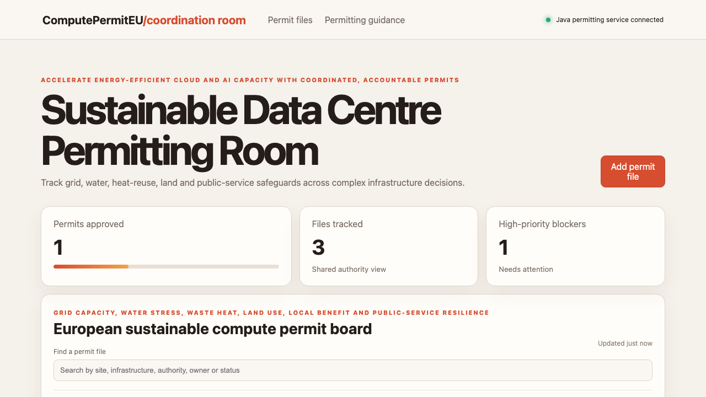

# Sustainable Data Centre Permitting Room

## One-sentence benefit

Help authorities and infrastructure teams coordinate energy-efficient data-centre permits and public safeguards.

## Live demo

[Watch the workflow](docs/demo.webm).

## Screenshots

## Main features

- Search and sort permit files by site, authority, owner or status.
- Create real permit records through the Java API.
- Advance files through draft, review and approved states.
- Show loading, empty, error and success feedback.
- Present operational and guidance sections responsively.

## Technology used

Angular, TypeScript, signals, HttpClient, SSR, Spring Boot and Java 21.

## Installation instructions

Install Node.js 22 and Java 21. Run `npm install`, start `cd backend && mvn spring-boot:run`, then run `npm start`.

## Commercial licensing/contact

Commercial licensing and integration support are available through the repository contact options.

## Business problem and users

Municipalities, grid operators, environmental authorities and investors need one decision view for complex compute infrastructure.

## Key workflows

Find a site, add a permit file, review resource blockers, advance approval and confirm the API result.

## Angular framework highlights

Signals provide derived state, OnPush change detection limits work, HttpClient performs real API writes and SSR remains configured.

## Java backend highlights

Spring Boot exposes validated list, search, create and update APIs, clear errors, health status and service tests.

## Architecture and state flow

Angular calls `/api/items`; Java validates requests and returns updated permit files to signal-based state.

## Accessibility and responsive behaviour

Semantic sections, labelled search, visible focus styles and responsive work rows support keyboard and small screens.

## Verification commands

Run `npm test`, `npm run build`, `cd backend && mvn test` and `cd backend && mvn package`.

## Structure

`src` contains the frontend, `backend` contains Java and `docs` contains inspected media.

## Tradeoffs

In-memory records simplify local use; production needs authentication, persistence and grid and permit integrations.

## Roadmap

Add geospatial constraints, grid queues, heat-reuse contracts, public consultation and environmental evidence.
